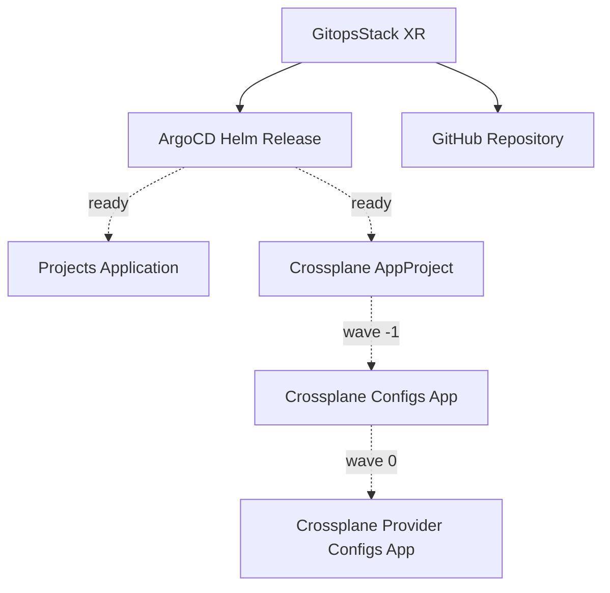
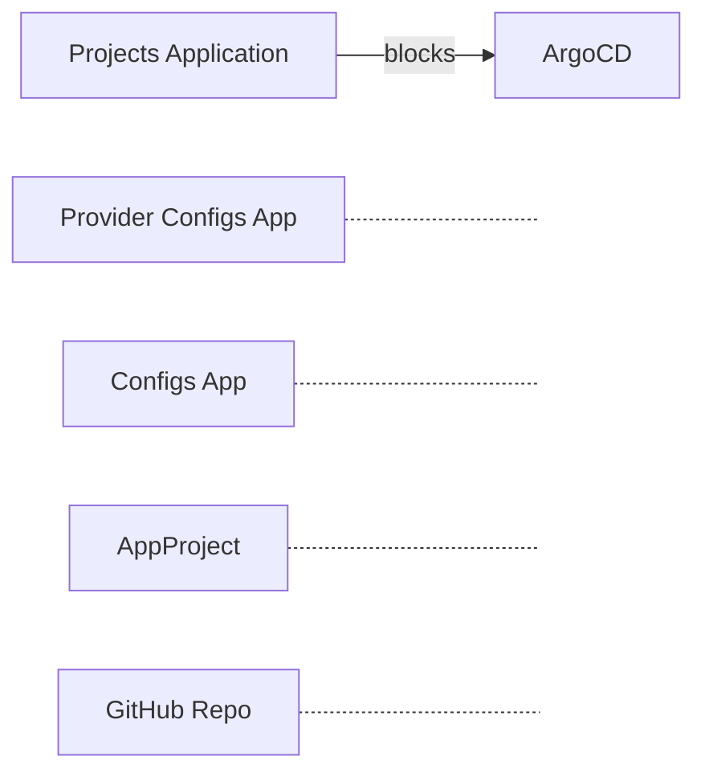

# gitops-stack

A single Crossplane resource that provisions a complete GitOps foundation: ArgoCD, a GitHub repository, and ArgoCD Applications wired to continuously sync from the repo.

## Why GitOps Stack?

**Without GitOps Stack:**
- 3 manual steps per cluster: install ArgoCD, create a repo, wire the two together
- ArgoCD Applications referencing wrong repo URLs or paths after copy-paste
- Deleting ArgoCD before its Applications causes orphaned resources and finalizer deadlocks
- GitHub repo creation is a manual, out-of-band process with inconsistent naming/settings
- Git pushes wait for ArgoCD's polling interval before applications refresh
- No single source of truth for "what GitOps infrastructure does this cluster have?"

**With GitOps Stack:**
- One resource, one API — ArgoCD, GitHub repo, and Applications all wired automatically
- Repo URL derived from org + cluster name — rename the cluster and everything adjusts
- Safe deletion ordering enforced via Usage resources (projects app deletes before ArgoCD)
- GitHub repo created with consistent settings (topics, visibility, branch cleanup, templates)
- Optional signed GitHub webhook refreshes ArgoCD immediately after pushes
- Optional Crossplane integration deploys configurations and provider configs via ArgoCD

## What Gets Deployed

```
                    ┌──────────────────────────────────┐
                    │          GitopsStack XR           │
                    └───────────────┬──────────────────┘
                                    │
                    ┌───────────────┼───────────────┐
                    ▼                               ▼
             ┌────────────┐                ┌────────────────┐
             │   ArgoCD   │                │ GitHub Repo    │
             │   (Helm)   │                │ (upjet-github) │
             └──────┬─────┘                └────────────────┘
                    │ ready
         ┌──────────┼──────────────────┐
         ▼          ▼                  ▼
  ┌────────────┐ ┌─────────────┐ ┌──────────────────┐
  │  Projects  │ │ Crossplane  │ │ Crossplane Apps   │
  │    App     │ │ AppProject  │ │ (configs +        │
  │            │ │             │ │  provider-configs) │
  └────────────┘ └─────────────┘ └──────────────────┘
                  └── only if crossplane.enabled ──┘
```

The base stack composes a Helm Release, GitHub Repository, ArgoCD Applications,
and deletion-ordering Usages. Optional OIDC adds target-cluster objects for the
Zitadel credentials, ProviderConfig, Project, OIDC application, and labeled
client Secret.

| Resource | Type | Purpose |
|----------|------|---------|
| ArgoCD | Helm Release (`argo-cd` v9.7.1) | Continuous delivery platform |
| GitHub Repository | `repo.github.m.upbound.io` | GitOps source repository |
| GitHub Repository Webhook | `repo.github.m.upbound.io` | Sends signed push events to ArgoCD |
| Webhook ExternalSecrets | Kubernetes Objects | Projects one AWS Secrets Manager value to GitHub and ArgoCD |
| Projects Application | Kubernetes Object (ArgoCD Application) | Syncs ArgoCD projects from the repo |
| Deletion Usage | Usage | Ensures projects app deletes before ArgoCD |
| Crossplane AppProject | Kubernetes Object (ArgoCD AppProject) | Scoped ArgoCD project for Crossplane |
| Crossplane Configs App | Kubernetes Object (ArgoCD Application) | Syncs Crossplane configurations |
| Crossplane Provider Configs App | Kubernetes Object (ArgoCD Application) | Syncs Crossplane provider configs |

## The Journey

### Stage 1: Getting Started

Two fields required. Everything else has sensible defaults.

```yaml
apiVersion: hops.ops.com.ai/v1alpha1
kind: GitopsStack
metadata:
  name: gitops
  namespace: default
spec:
  clusterName: my-cluster
  repository:
    org: hops-ops
```

This deploys:
- ArgoCD into the `argocd` namespace with CRDs, monitoring, and service monitors enabled
- GitHub repo `hops-ops/my-cluster-gitops` (private, auto-initialized)
- Projects Application syncing from `.gitops/deploy` in the repo (once ArgoCD is ready)

### Stage 2: Customizing for Your Team

Add labels, use a template repo, tune ArgoCD.

```yaml
apiVersion: hops.ops.com.ai/v1alpha1
kind: GitopsStack
metadata:
  name: gitops
  namespace: default
spec:
  clusterName: production
  labels:
    team: platform
    environment: production
  repository:
    org: hops-ops
    name: production-gitops
    description: GitOps for production cluster
    topics: [gitops, argocd, production]
    template:
      owner: hops-ops
      repository: platform-gitops-template
  argocd:
    values:
      server:
        ingress:
          enabled: true
          hostname: argocd.example.com
```

When `template` is set, the repo is created from the template instead of auto-init.

#### Immediate refresh after GitHub pushes

Enable the native ArgoCD webhook to replace its polling delay with push-driven
refreshes. By default, External Secrets generates the shared value once and
pushes it to AWS Secrets Manager. The Helm Release stores only a reference to
the External Secrets-managed Kubernetes Secret.

```yaml
spec:
  exposure:
    enabled: true
    hostname: argocd.example.com
  repository:
    org: hops-ops
    webhook:
      enabled: true
      secretStoreName: default
      secretPath: push/example-cluster/argo/github-webhook
      secretKey: webhookSecret
      maxPayloadSizeMB: 10
```

This creates a GitHub `push` webhook for
`https://argocd.example.com/api/webhook`. The generated secret uses
`updatePolicy: IfNotExists` and is retained when the stack is deleted, making
AWS Secrets Manager the durable source of truth. SecretStack, a path under its
`push/*` write boundary, and a publicly reachable webhook endpoint are required. Set
`generate: false` to read a pre-existing secret from another path instead.


#### Private UI with a separate public webhook

Set `repository.webhook.url` to a public HTTPS endpoint when the UI hostname
resolves to a private Gateway. The URL must end in `/api/webhook` and cannot
contain credentials, a query string or a fragment. An explicit port must be
between 1 and 65535. Without this override the
existing `https://<exposure.hostname>/api/webhook` behavior is unchanged.

```yaml
spec:
  exposure:
    enabled: true
    hostname: argocd.example.com
    gatewayRef:
      name: private
      namespace: ingress
      sectionName: https-argocd
    routeAnnotations:
      external-dns.alpha.kubernetes.io/cloudflare-proxied: "false"
  repository:
    org: hops-ops
    webhook:
      enabled: true
      url: https://argocd-webhook.example.com/api/webhook
      secretPath: push/example-cluster/argo/github-webhook
```

The webhook override updates the URL exported in the shared Kubernetes Secret;
GitopsEnvironment consumers of that Secret follow it on reconciliation. It does
not rotate the HMAC secret, change the UI URL, alter native OIDC callbacks or
create a public route. Provision a separate public HTTPRoute before changing
webhook URLs. Restrict that route to `POST` and the exact `/api/webhook` path,
backed by `argocd-server:80` in the Argo namespace; keep all UI/API paths private.
Require `X-GitHub-Event` to be `push` or `ping`, and remove competing provider
headers (`X-Vss-Activityid`, `X-Gogs-Event`, `X-Gitlab-Event`, `X-Hook-UUID`,
`X-Event-Key`) before forwarding. Argo shares this endpoint across providers;
these restrictions ensure requests use the GitHub handler and its existing
shared HMAC verification. Verify new GitHub deliveries
before moving the UI's DNS and Gateway parent. A webhook may also use an explicit
URL with `exposure.enabled: false` if routing is managed separately. In that
case the XR does not select backend TLS for the externally managed route. For
TLS termination at the Gateway with an HTTP `argocd-server:80` backend, set:

```yaml
spec:
  argocd:
    values:
      configs:
        params:
          server.insecure: "true"
```

Alternatively, keep Argo's server TLS enabled and configure the externally
managed Gateway's backend TLS appropriately. Match the backend scheme to this
setting: GitHub webhook POSTs must reach the handler without an HTTP-to-HTTPS
redirect. The public webhook URL itself remains HTTPS in either case.

`exposure.routeAnnotations` applies only to the UI HTTPRoute. Typed annotation
keys take precedence over matching `argocd.values.server.httproute.annotations`
keys while retaining unrelated raw annotations. Other Helm values and resources
are unaffected. The public/private network boundary belongs to the chosen
Gateway and DNS target; annotations alone do not make an endpoint private.

### Stage 3: Crossplane Integration

Enable ArgoCD-managed Crossplane resources for full platform automation.

```yaml
spec:
  clusterName: production
  repository:
    org: hops-ops
  applications:
    projects:
      path: .gitops/deploy
    crossplane:
      enabled: true
```

This adds 3 ArgoCD resources (gated on ArgoCD readiness):
- **AppProject** `crossplane` — scoped project allowing all sources and destinations
- **Application** `crossplane-configurations` — syncs from `resources/crossplane/configurations`
- **Application** `crossplane-provider-configs` — syncs from `resources/crossplane/provider-configs`

Sync waves ensure ordering: AppProject (-1) → configurations (0) → provider-configs (1).

### Stage 4: Local Development

For Colima/kind/minikube — use `default` provider configs instead of cluster-named ones.

```yaml
apiVersion: hops.ops.com.ai/v1alpha1
kind: GitopsStack
metadata:
  name: gitops
  namespace: default
spec:
  clusterName: local
  helmProviderConfigRef:
    name: default
  kubernetesProviderConfigRef:
    name: default
  githubProviderConfigRef:
    name: default
  repository:
    org: hops-ops
```

### Stage 5: Full Override

When you need complete control over ArgoCD's Helm values (bypassing all defaults):

```yaml
spec:
  argocd:
    overrideAllValues:
      crds:
        install: false
      server:
        replicas: 3
```

`overrideAllValues` replaces **all** defaults — chart defaults, monitoring config, everything. Use `values` for additive changes instead.

### Stage 6: Gateway exposure and Zitadel OIDC

Expose ArgoCD through an existing Gateway listener and configure ArgoCD's
native OIDC support. GitopsStack creates a dedicated Zitadel Project and OIDC
application in the target cluster. The generated client secret stays in
Kubernetes and is referenced by name from `argocd-cm`; it is never stored in
the XR or Helm values.

```yaml
spec:
  exposure:
    enabled: true
    hostname: argocd.example.com
    gatewayRef:
      name: platform
      namespace: istio-ingress
      sectionName: https
  auth:
    oidc:
      enabled: true
      issuerURL: https://auth.example.com
      rbac:
        adminEmails:
        - platform-admin@example.com
      zitadel:
        # AuthStack status.providerConfig.awsSecretsManagerPath
        awsSecretsManagerPath: push/my-cluster/zitadel-credentials
```

Prerequisites are Gateway API, External Secrets Operator with the configured
ClusterSecretStore, Crossplane's namespaced Zitadel provider in the target
cluster, and an AuthStack-published management access token. TLS terminates at
the Gateway, so the generated HTTPRoute sends cleartext HTTP to ArgoCD inside
the cluster. ArgoCD CLI users should use `--grpc-web` through this HTTPRoute.

When enabled, typed exposure and OIDC settings take precedence over conflicting
raw Helm values so the public URL, callback, and client remain consistent.
Local ArgoCD admin login remains enabled as a break-glass path.

## Creation Order

Resources are created as their dependencies become ready:



ArgoCD and the GitHub repo start immediately. All Applications wait for ArgoCD to be ready.

## Deletion Order

Usage resources enforce safe teardown — dependents delete before the resources they depend on:



| Phase | Deletes | Waits for |
|-------|---------|-----------|
| 1 | GitHub repo, Crossplane apps, AppProject | nothing — immediate |
| 2 | Projects Application | nothing — immediate |
| 3 | ArgoCD | Projects Application gone |

The Usage ensures ArgoCD CRDs stay alive until all ArgoCD Application CRs are cleaned up.

## Spec Reference

| Field | Type | Required | Default | Description |
|-------|------|----------|---------|-------------|
| `clusterName` | string | yes | — | Target cluster name; drives naming defaults |
| `namespace` | string | no | `argocd` | Namespace for ArgoCD and applications |
| `labels` | map | no | `{}` | Custom labels merged with defaults |
| `managementPolicies` | []string | no | `["*"]` | Crossplane management policies |
| `helmProviderConfigRef.name` | string | no | `clusterName` | Helm ProviderConfig name |
| `helmProviderConfigRef.kind` | string | no | `ProviderConfig` | `ProviderConfig` or `ClusterProviderConfig` |
| `kubernetesProviderConfigRef.name` | string | no | `clusterName` | Kubernetes ProviderConfig name |
| `kubernetesProviderConfigRef.kind` | string | no | `ProviderConfig` | `ProviderConfig` or `ClusterProviderConfig` |
| `githubProviderConfigRef.name` | string | no | `default` | GitHub ProviderConfig name |
| `githubProviderConfigRef.kind` | string | no | `ProviderConfig` | `ProviderConfig` or `ClusterProviderConfig` |
| `argocd.name` | string | no | `argocd` | Helm release name |
| `argocd.namespace` | string | no | `namespace` | Per-component namespace override |
| `argocd.values` | object | no | `{}` | Helm values merged with defaults |
| `argocd.overrideAllValues` | object | no | — | Helm values replacing all defaults |
| `exposure.enabled` | boolean | no | `false` | Create an ArgoCD HTTPRoute |
| `exposure.hostname` | string | with exposure | — | ArgoCD UI hostname |
| `exposure.routeAnnotations` | map of strings | no | `{}` | Annotations on only the ArgoCD HTTPRoute |
| `exposure.gatewayRef.*` | object | no | `platform` / `istio-ingress` / `https` | Existing Gateway listener |
| `auth.oidc.enabled` | boolean | no | `false` | Enable native ArgoCD OIDC with Zitadel |
| `auth.oidc.issuerURL` | string | with OIDC | — | Zitadel issuer URL |
| `auth.oidc.rbac.adminEmails` | []string | no | `[]` | Explicit email-to-admin mappings |
| `auth.oidc.zitadel.awsSecretsManagerPath` | string | with OIDC | — | AuthStack-published PAT path |
| `repository.org` | string | yes | — | GitHub organization |
| `repository.name` | string | no | `{clusterName}-gitops` | Repository name |
| `repository.externalName` | string | no | — | Existing repository name to import instead of creating a new repository |
| `repository.description` | string | no | auto-generated | Repository description |
| `repository.visibility` | string | no | `private` | `public`, `private`, or `internal` |
| `repository.autoInit` | boolean | no | `true` | Create initial commit (ignored when template is set) |
| `repository.template.owner` | string | no | — | Template repo owner |
| `repository.template.repository` | string | no | — | Template repo name |
| `repository.topics` | []string | no | `[]` | Repository topics |
| `repository.deleteBranchOnMerge` | boolean | no | `true` | Auto-delete head branches on merge |
| `repository.webhook.enabled` | boolean | no | `false` | Create a signed GitHub push webhook for immediate ArgoCD refreshes |
| `repository.webhook.url` | string | no | `https://<exposure.hostname>/api/webhook` | Independent public HTTPS webhook endpoint |
| `repository.webhook.generate` | boolean | no | `true` | Generate the shared secret once and push it to AWS Secrets Manager |
| `repository.webhook.secretStoreName` | string | no | `externalSecrets.secretStoreName` or `default` | ClusterSecretStore used to push and read the shared secret |
| `repository.webhook.secretPath` | string | when enabled | — | AWS Secrets Manager path containing the shared secret |
| `repository.webhook.secretKey` | string | no | `webhookSecret` | JSON property containing the shared secret |
| `repository.webhook.maxPayloadSizeMB` | integer | no | `10` | Maximum webhook payload accepted by ArgoCD |
| `externalSecrets.githubToken.secretPath` | string | no | — | AWS Secrets Manager secret containing a GitHub token |
| `externalSecrets.githubToken.tokenKey` | string | no | `token` | JSON key containing the token |
| `externalSecrets.githubToken.username` | string | no | `x-access-token` | HTTPS username for ArgoCD repository credentials |
| `applications.apps.enabled` | boolean | no | `true` | Deploy the root app-of-apps Application |
| `applications.apps.path` | string | no | `apps` | Path in repo to sync |
| `applications.crossplane.enabled` | boolean | no | `false` | Deploy Crossplane integration apps |

**ArgoCD chart defaults** (merged with `argocd.values`):

```yaml
crds:
  install: true
global:
  monitoring:
    enabled: true
    serviceMonitor:
      enabled: true
```

## Status

| Field | Type | Description |
|-------|------|-------------|
| `status.ready` | boolean | `true` when all composed resources report Ready |
| `status.repository.url` | string | Full URL of the managed GitHub repository |

## Dependencies

| Kind | Package | Version |
|------|---------|---------|
| Function | crossplane-contrib/function-auto-ready | ^v0 |
| Provider | crossplane-contrib/provider-helm | ^v1 |
| Provider | crossplane-contrib/provider-kubernetes | ^v1 |
| Provider | crossplane-contrib/provider-upjet-github | ^v0 |

## Development

```bash
make render          # Render all examples
make render:minimal  # Render a single example
make validate        # Validate all rendered output
make test            # Run KCL unit tests
make e2e             # Run E2E tests (requires GitHub App credentials)
make build           # Build the Crossplane package
make publish tag=v1  # Build and push to registry
```

## License

Apache-2.0
